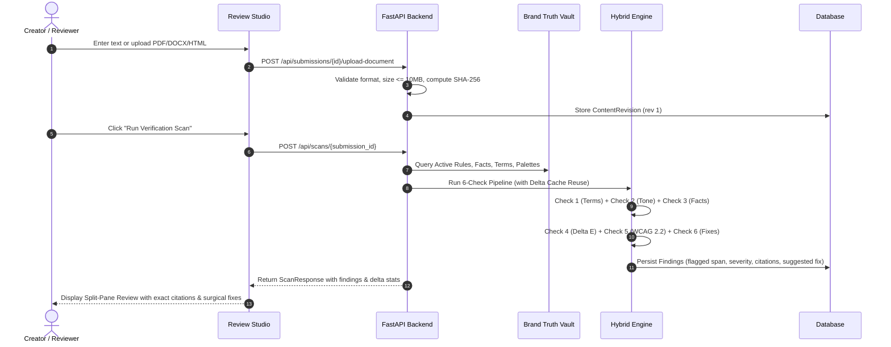

# VeriLoom — System Architecture & Technical Design

**Project:** VeriLoom — Intelligent Brand-Governance Studio  
**Hackathon:** Inkloom AI Hackathon | Round 2: The Build  
**Version:** 1.0.0  
**Stack:** React 18, TypeScript, Tailwind CSS, FastAPI, SQLAlchemy, SQLite/PostgreSQL, ReportLab  

---

## 1. System Overview

VeriLoom is an enterprise pre-publication content-governance studio that systematically verifies marketing drafts, announcements, whitepapers, and visual assets against approved organizational standards before release.

```mermaid
flowchart TD
    subgraph Client ["Client Presentation Tier (React 18 + TypeScript)"]
        UI["Review Studio / Brand Truth Vault / Visual Auditor / Approvals / Insights"]
        Router["HashRouter Navigation (Static & Subpath Safe)"]
        APIClient["API Client (with Live Backend Probing & Offline Fallback)"]
    end

    subgraph ServerTier ["Application Tier (FastAPI + Python 3.12)"]
        AuthMiddleware["JWT Authentication & RBAC Guard"]
        UploadValidators["Document & Image Validation (10MB, Format Whitelisting)"]
        
        subgraph Engine ["6-Check Hybrid Verification Pipeline"]
            C1["Check 1: Terminology Regex Filter"]
            C2["Check 2: Tone Auditor"]
            C3["Check 3: Fact & Claim Matcher"]
            C4["Check 4: CIE76 Delta E Color Extractor"]
            C5["Check 5: WCAG 2.2 Contrast & Alt-Text"]
            C6["Check 6: Surgical Intent-Preserving Fixes"]
        end

        subgraph ThreeImprovements ["The 3 Named Improvements"]
            Imp1["Imp 1: SHA-256 Delta Scanning & Paragraph Hashing"]
            Imp2["Imp 2: Guideline-Patch Recommender (40% Override Gate)"]
            Imp3["Imp 3: HMAC-SHA256 Signed Compliance Certificate & PDF"]
        end
    end

    subgraph DataTier ["Persistence Tier (SQLAlchemy ORM)"]
        DB[("PostgreSQL / SQLite Storage Engine")]
        VaultTables["rules, facts, terms, palettes"]
        SubmissionTables["submissions, revisions, findings, comments"]
        AuditTables["audit_events, certificates"]
    end

    UI --> Router
    Router --> APIClient
    APIClient -->|HTTP / REST| AuthMiddleware
    AuthMiddleware --> UploadValidators
    UploadValidators --> Engine
    Engine --> ThreeImprovements
    ThreeImprovements --> DataTier
```

---

## 2. The 6-Check Verification Pipeline

---

## 3. The Three Promised Improvements

### Improvement 1: SHA-256 Delta Scanning & Visual Version Diff
- **Mechanism:** When a revision is saved or updated, `DeltaHasher` computes the document-level SHA-256 hash and individual SHA-256 hashes for each paragraph.
- **Cache Reuse:** When re-scanning subsequent revisions, paragraphs whose hashes are identical to the previous revision bypass redundant scanning. Previous findings for those paragraphs are reused instantly.
- **Visual Diff:** `DiffViewer.tsx` tokenizes before/after content and renders side-by-side green (added) and red (removed) differences.

### Improvement 2: Interactive Guideline-Patch Recommender
- **Friction Detection:** `GuidelinePatchRecommender` continuously analyzes audit records for every rule in the Brand Truth Vault.
- **Threshold Rule:** If a rule has at least 2 findings and an override rate $\ge 40\%$, it flags a "Statistical Friction Alert".
- **Disambiguation:** The engine synthesizes reviewer feedback and drafts a proposed guideline patch.
- **Governance Gate:** A patch is never applied autonomously; it requires explicit Brand Admin approval, which increments the rule version (`version += 1`) and logs an audit record.

### Improvement 3: Pre-Flight Compliance Certificate
- **Trigger:** Only enabled when a submission reaches `APPROVED` status from an authorized Reviewer or Brand Admin.
- **Cryptographic Security:** Constructs a canonical JSON payload containing `submission_id`, `revision_number`, `source_file_sha256`, `vault_version`, `approver_id`, and `approval_timestamp`. Computes an HMAC-SHA256 signature using the secret key.
- **PDF Generation:** Generates a downloadable, high-resolution vector PDF using ReportLab with embedded QR verification hashes and structured findings summaries.
- **Tamper Resistance:** `verify_certificate` re-computes the HMAC-SHA256 signature against the canonical payload. Any modification to the title, hash, or approver immediately invalidates the signature.

---

## 4. Database Schema Design

- **`organizations`**: Multi-tenant isolation boundary.
- **`users`**: Role-based identities (`Creator`, `Reviewer`, `Brand Admin`) with bcrypt hashed passwords.
- **`brand_rules`**: Versioned brand rules (`PR-101`, `TN-202`, etc.) with clause IDs, source document citations, and version history.
- **`approved_facts`**: Grounded enterprise facts with effective dates, expiration dates, and exact source quotes.
- **`terminology_rules`**: Banned terms, preferred alternatives, whole-word matching flags, and case sensitivity toggles.
- **`brand_color_palettes`**: Hex codes, RGB, CIELAB ($L^*a^*b^*$), roles, and Delta E tolerances.
- **`content_submissions`**: Governed assets with state machine (`DRAFT`, `SCANNED`, `CHANGES_REQUESTED`, `PENDING_REVIEW`, `APPROVED`, `REJECTED`).
- **`content_revisions`**: Immutable revision history with document SHA-256 hashes and paragraph hash arrays.
- **`findings`**: Specific violations/warnings with paragraph indices, character spans (`span_start`, `span_end`), exact rule citations, and suggested replacements.
- **`submission_comments`**: Reviewer feedback tied to specific findings or revisions.
- **`audit_events`**: Immutable audit log capturing user ID, action type, outcome, reason, and timestamps.
- **`compliance_certificates`**: HMAC-SHA256 digitally signed certificates with cryptographic verification hashes.
